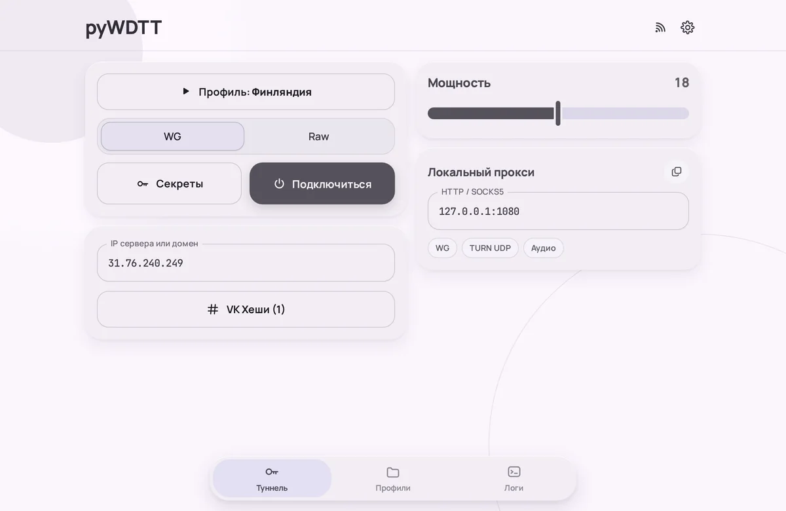
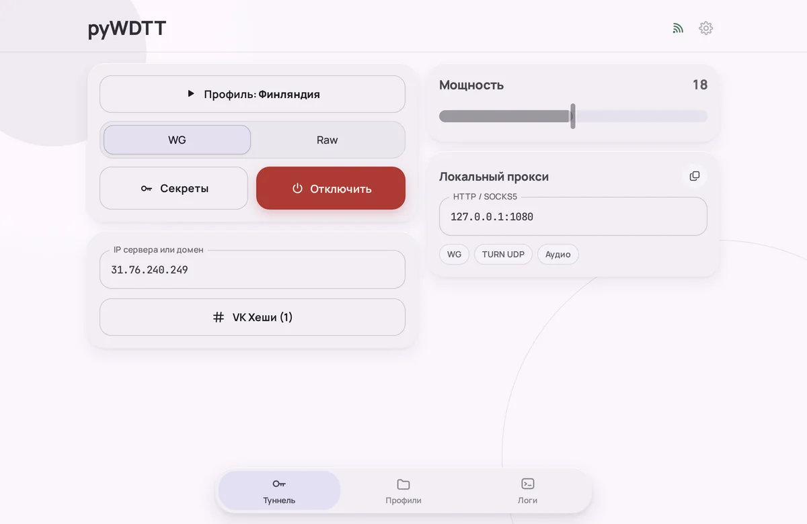
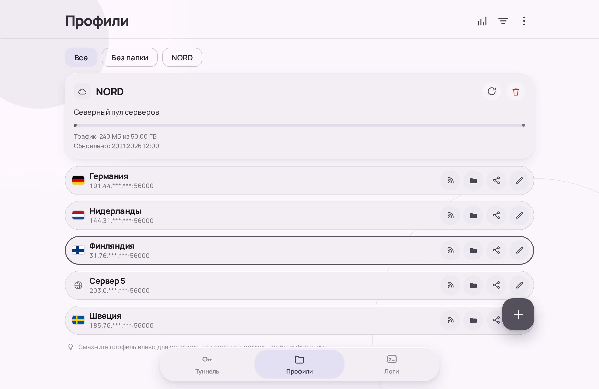
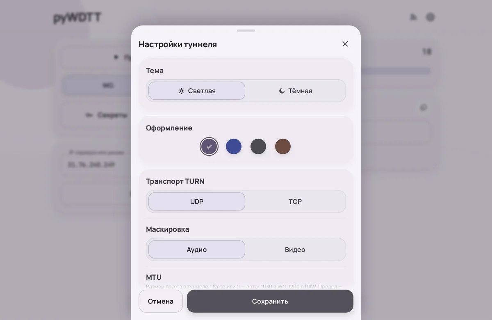
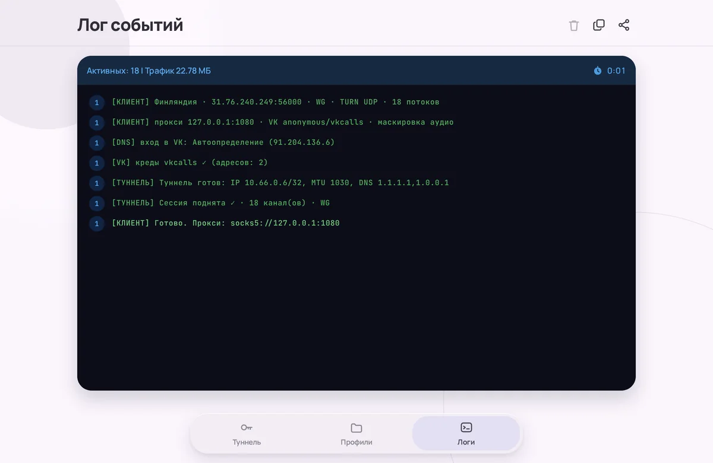
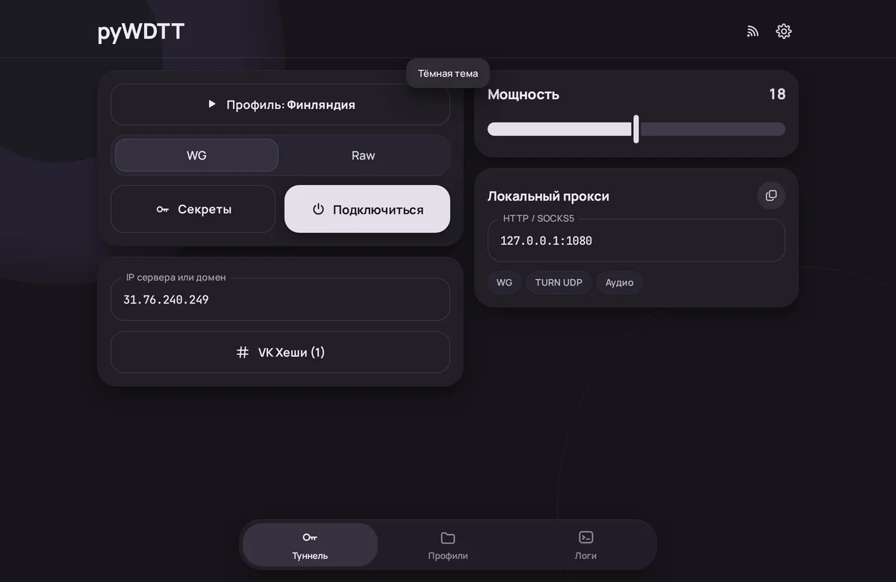

<div align="center">


# pyWDTT

**Десктопный клиент qWDTT: туннель WireGuard поверх DTLS через TURN-инфраструктуру звонков VK. Две сборки одного кода — «всё внутри» для Windows и лёгкая для любой системы.**


[](https://justac0d1x.github.io/PyWDTT/)

[Сайт](https://justac0d1x.github.io/PyWDTT/) · [Скачать](#две-сборки) · [Возможности](#возможности) · [CLI](#командная-строка) · [Как устроено](#как-это-устроено) · [Лицензия](#лицензия)

</div>

---

## Что это

**qWDTT** — Android-приложение, которое поднимает системный VPN и уводит трафик через TURN-серверы звонков VK: для сети такое соединение выглядит как медиатрафик WebRTC-звонка, а не как подключение к VPN-серверу. Трафик выходит в интернет на вашем собственном VPS.

**pyWDTT** переносит эту схему на компьютер: два интерфейса в одном файле, плюс лёгкая сборка для систем без Windows.

- **GUI** — тот же интерфейс, что в Android-версии (пастельные карточки, нижняя навигация, палитры, тёмная тема), отрисованный в окне через `pywebview` (Edge WebView2 в Windows, GTK или Qt в Linux);
- **headless-клиент** — полноценный CLI с тем же набором параметров, что у Go-клиента из оригинального проекта.

Вместо системного VPN (как на телефоне) компьютер поднимает **локальный SOCKS5/HTTP-прокси** — права администратора не нужны, потому что TCP/IP-стек и WireGuard (Noise_IK) реализованы в userspace на чистом Python.

```
приложение → 127.0.0.1:1080 → pyWDTT → DTLS в RTP-обфускации → TURN VK → ваш VPS → интернет
```

## Скриншоты

<p align="center">
  
  
</p>
<p align="center">
  
  
</p>
<p align="center">
  
  
</p>

Живой интерфейс можно потрогать на [сайте проекта](https://justac0d1x.github.io/PyWDTT/) — там же демо с имитацией подключения.

## Две сборки

Код один и тот же — отличается только тем, как он получает `cryptography`. Обе работают без интернета: ничего не докачивается в рантайме.

|  | **`pyWDTT.pyw`** — всё внутри | **`pyWDTT-universal.py`** — лёгкая |
|---|---|---|
| Размер | 13.5 МБ | 0.75 МБ |
| Системы | Windows 10/11, x64 и x86 | Windows, Linux, macOS — везде, где есть Python 3.7+ |
| Криптография | 18 колёс внутри файла (`cryptography`, `cffi`, `pycparser` под Python 3.7–3.13) | системный пакет `cryptography`, если он установлен, иначе встроенная реализация на чистом Python |
| Что нужно до запуска | Python + Edge WebView2 | Python; для окна — WebView2 (Windows) либо GTK/Qt (Linux); `pip install cryptography` — по желанию |
| Запуск | двойной клик, ничего не настраивается | `python3 pyWDTT-universal.py` или `./pyWDTT-universal.py` |
| Кому | обычный пользователь Windows: скачал — работает | серверы, Linux/macOS, скрипты, аудит кода |

Обе сборки собираются из одного источника: `python3 build_lite.py` берёт `pyWDTT.pyw` и вырезает из него вшитые колёса, получая `pyWDTT-universal.py`. Никаких «двух кодовых баз», расхождение исключено.

## Возможности

- **Один файл.** В `pyWDTT.pyw` лежит всё — интерфейс, иконка и библиотеки: скопировали на флешку и запустили двойным кликом, без `pip` и без интернета.
- **Офлайн-библиотеки.** 18 встроенных колёс: `cryptography`, `cffi`, `pycparser` для Python 3.7–3.13 и обеих разрядностей Windows. Проверка sha256 перед распаковкой, каталог `%TEMP%\qwdtt-libs-<хеш>`.
- **Работает и без библиотек.** Если встроенное колесо не подошло (или это лёгкая сборка на Linux) — включается встроенная криптография на чистом Python; флаг `QWDTT_CRYPTO=pure` выбирает её принудительно.
- **Профили и VK-хеши.** Несколько серверов, папки, сортировка, импорт ссылки `wdtt://config?...`, список хешей звонков с быстрым переключением.
- **Режимы и транспорт.** WG / Raw, UDP / TCP, обфускация «аудио» или «видео», MTU, выбор DNS.
- **«Мощность».** Ползунок числа параллельных потоков: больше — быстрее на многопоточных загрузках, меньше — бережнее к CPU.
- **Локальный прокси.** HTTP и SOCKS5 на `127.0.0.1:1080` (порт настраивается), опциональная авторизация, апстрим-прокси.
- **Наблюдаемость.** Живой журнал с таймером, копированием и сохранением в файл; шторка «Секреты» со всеми параметрами подключения.
- **Оформление.** Светлая и тёмная тема × 4 палитры: Лаванда, Индиго, Графит, Карамель.
- **Криптография.** Нативная через `cryptography` из встроенного колеса (~89 МБ/с на шифрование) либо полностью встроенная реализация (ChaCha20-Poly1305, AES-GCM, X25519, ECDH P-256) — на случай, если колесо не подошло.

## Установка

**Общее требование:** Python 3.7–3.13. Дальше выбираете сборку.

### Windows: всё внутри (`pyWDTT.pyw`)

1. Скачайте `pyWDTT.pyw` из [Releases](https://github.com/justac0d1x/PyWDTT/releases) или с сайта проекта.
2. Положите в любую папку, например `C:\Apps`.
3. Двойной клик — откроется окно. Или `python pyWDTT.pyw` из консоли.

Microsoft Edge WebView2 Runtime нужен для окна и уже есть в Windows 10/11. Библиотеки распаковываются во `%TEMP%\qwdtt-libs-<хеш>` при первом запуске — это локальная операция, интернет не используется.

### Любая система: лёгкая сборка (`pyWDTT-universal.py`)

```bash
python3 pyWDTT-universal.py                 # окно (нужен pywebview)
python3 pyWDTT-universal.py --help          # консольный режим, список ключей
```

```bash
pip install cryptography         # по желанию: в разы быстрее встроенной реализации
```

Для окна на Linux нужен GTK (`python3-gi`) или Qt (`pip install pywebview[qt]`); на Windows — WebView2. Без графики всё работает через консоль.

**В любом случае нужен свой VPS с серверной частью qWDTT** (см. [qWDTT для Android](https://github.com/SpaceNeuroX/proxy-turn-vk-android)) и **хеш звонка VK** — без них туннель поднять нечем.

Если окно не открылось, вывод пишется в `%TEMP%\qwdtt-window.log` (`Win+R` → `%TEMP%`), а при запуске из консоли — сразу в терминал.

## Командная строка

Обе сборки работают и без интерфейса: без аргументов открывается окно, с ключами запускается консольный клиент.

```bash
python pyWDTT.pyw --vk ХЕШ --peer 1.2.3.4:56000 --password ПАРОЛЬ \
                  --mode socks --socks 127.0.0.1:1080

python3 pyWDTT-universal.py --vk ХЕШ --peer 1.2.3.4:56000 --password ПАРОЛЬ --mode wg
python3 pyWDTT-universal.py --vk ХЕШ --peer 1.2.3.4:56000 --password ПАРОЛЬ --check-hashes
```

`pyWDTT.pyw` принимает те же ключи. Основные: `--vk`, `--peer`, `--password`, `--mode wg|raw|socks`, `--turn`, `--turn-transport udp|tcp`, `--obfs audio|video`, `--mtu`, `--dns`, `--socks`, `--socks-auth`, `--up-proxy`, `--captcha-command`, `--captcha-token-file`, `--interface auto|gui|console`. Полный список — `python pyWDTT.pyw --help`.

## Проверка

В репозитории есть автономная самопроверка — работает на любом Python 3.7+ и не требует сети:

```bash
python selftest_offline.py                     # рядом с pyWDTT.pyw / pyWDTT-universal.py
QWDTT_CRYPTO=pure python selftest_offline.py   # принудительно чистый Python
```

Скрипт сам находит `pyWDTT.pyw` или `pyWDTT-universal.py` в своей папке — положите его рядом с той сборкой, которую проверяете.

Ожидаемый итог — `Все проверки пройдены ✓`. Скрипт проверяет встроенную криптографию на официальных векторах (NIST GCM TC2/TC4, Poly1305 RFC 8439, X25519) и сквозные сценарии: обфускацию RTP, WireGuard AEAD, record layer DTLS.

Сверка скачанного файла:

```bat
certutil -hashfile pyWDTT.pyw SHA256
certutil -hashfile pyWDTT-universal.py SHA256
```

Актуальный хеш указан в [Releases](https://github.com/justac0d1x/PyWDTT/releases) и на странице проекта.

## Как это устроено

**Встроенные колёса.** Для каждой версии Python подобран рабочий набор; всё лежит внутри файла как zlib+base64 и распаковывается при первом запуске только для своего процесса:

| Python | cffi | cryptography | Платформы |
|---|---|---|---|
| 3.7 | 1.15.1 | 45.0.7 (cp37-abi3) | win32 · win_amd64 |
| 3.8 | 1.17.1 | 45.0.7 (cp37-abi3) | win32 · win_amd64 |
| 3.9 | 2.0.0 | 45.0.7 (cp37-abi3) | win32 · win_amd64 |
| 3.10 – 3.13 | 2.1.1 | 45.0.7 (cp37-abi3) | win32 · win_amd64 |
| любая | — | встроенная реализация | везде |

Плюс `pycparser` (чистый Python). Перед распаковкой каждый файл сверяется по sha256, готовность каталога отмечается маркером, при повторных запусках распаковка не повторяется.

**Как получаются две сборки.** `build_lite.py` вырезает из `pyWDTT.pyw` блоки `_BUNDLED_WHEELS` и `_BUNDLED_SHA256` — всё остальное совпадает побайтно:

```bash
python3 build_lite.py            # pyWDTT.pyw → pyWDTT-universal.py (размер + sha256)
python3 site_src/build_site.py   # собирает сайт и кладёт рядом обе сборки
```

**Переопределения окружения:**

| переменная | смысл |
|---|---|
| `QWDTT_CRYPTO=pure` | игнорировать нативное колесо, считать встроенной реализацией |
| `QWDTT_LIBS_DIR=<путь>` | свой каталог для распаковки колёс вместо `%TEMP%` |

В лёгкой сборке `QWDTT_CRYPTO=pure` работает так же — просто там выбор и так сводится к двум вариантам: системный `cryptography` или встроенный.

**Что сделано вручную, без внешних зависимостей:** TURN-клиент, DTLS, RTP-обфускация (ChaCha20-Poly1305 «как OPUS»), WireGuard (Noise_IK), userspace TCP/IP-стек, SOCKS5, цепочка DNS. Они же покрыты самопроверкой.

**Окно.** `pywebview` + WebView2, интерфейс — локальный HTML/CSS/JS с вшитым шрифтом Manrope. Иконка приложения тоже внутри файла: она ставится на окно, консоль и панель задач через `WM_SETICON` и `AppUserModelID`, а в демо-режиме в браузере работает как favicon.

## Сайт

**[Открыть сайт →](https://justac0d1x.github.io/PyWDTT/)** · [демо интерфейса](https://justac0d1x.github.io/PyWDTT/demo.html)

Лендинг для GitHub Pages собирается из `site_src/` одной командой (`python3 site_src/build_site.py`) и публикуется workflow-ом `.github/workflows/pages.yml`: описание, **живой интерфейс прямо на странице** (тот же HTML, что в окне приложения, — кликается, подключается, переключает темы), установка, скачивание и проверка контрольной суммы. Чтобы включить публикацию, достаточно один раз выбрать **Settings → Pages → Source: GitHub Actions** — дальше сайт пересобирается на каждый пуш.

## Структура репозитория

```
pyWDTT.pyw             ← сборка «всё внутри» (Windows, 13.5 МБ) — основной продукт
pyWDTT-universal.py    ← та же программа без вшитых колёс (любая ОС, 0.75 МБ)
build_lite.py          ← делает pyWDTT-universal.py из pyWDTT.pyw (один источник кода)
selftest_offline.py    ← автономная самопроверка криптографии, сети не требует
pyWDTT.ico             ← иконка приложения (16–256 px, она же вшита в оба файла)
LICENSE                ← GNU GPL v3
docs/screenshots/      ← картинки для README (icon.png и скриншоты интерфейса)
site_src/              ← шаблон лендинга, ассеты и сборщик
site/                    генерируется: python3 site_src/build_site.py (в git не хранится)
.github/workflows/     ← CI: самопроверка, релиз по тегу, публикация сайта
```

Правило простое: правим только `pyWDTT.pyw`, потом `python3 build_lite.py` и `python3 site_src/build_site.py`. Руками `pyWDTT-universal.py` не редактируется — при следующей сборке правки потеряются.

Сайт полностью автономен: шрифты, иконка и сам интерфейс приложения вшиты в `index.html`. Отдельная копия интерфейса лежит в `demo.html` — на неё ведёт ссылка «во весь экран».

## Ограничения

- Работает только со **своим** сервером и своим хешем звонка VK — публичных «ключей» не существует.
- Это **не системный VPN**, а локальный прокси: браузер или приложение нужно направить на `127.0.0.1:1080`.
- Скорость упирается в канал TURN (на практике единицы Мбит/с); встроенная криптография на чистом Python медленнее нативной примерно на два порядка — на слабых машинах заметно.
- Лёгкая сборка без установленного `cryptography` считает на чистом Python: это надёжно и переносимо, но медленно (порядок ~1 МБ/с на поток). На слабом CPU поставьте `pip install cryptography`.
- Интерфейс в лёгкой сборке требует графической библиотеки: WebView2 в Windows, GTK или Qt в Linux; без них остаётся консольный режим.
- Неподписанные `.pyw`/`.py`, которые шифруют трафик и пишут в `%TEMP%`, могут вызвать вопросы у SmartScreen и эвристики антивирусов. Сверяйте SHA-256.
- Используйте на своих серверах и в рамках закона и правил вашего оператора связи.

## Лицензия

**GNU GPL v3** — файл [`LICENSE`](LICENSE) лежит в корне репозитория.

Почему именно она, а не MIT или Apache-2.0:

- pyWDTT — производная работа: интерфейс, иконка, наборы режимов и логика клиента взяты из [qWDTT для Android](https://github.com/SpaceNeuroX/proxy-turn-vk-android), который распространяется под GPL-3.0. GPL требует, чтобы производные работы оставались под GPL. Лицензии MIT/Apache здесь просто несовместимы юридически.
- GPL-3.0 закрывает и патентную часть, и «антитивоизацию»: никто не сможет взять код, добавить проприетарные модули и закрыть результат.
- Для пользователя это ничего не усложняет: скачивать и запускать можно свободно, менять под себя — тоже; меняется только одно — если вы распространяете изменённую версию, её исходники должны быть открыты.

Если хочется разрешительнее (MIT), единственный честный путь — писать клиент с нуля, не используя код и ассеты qWDTT; тогда лицензию можно выбрать любую.

### Происхождение

pyWDTT — самостоятельное развитие [qWDTT для Android](https://github.com/SpaceNeuroX/proxy-turn-vk-android) (интерфейс, иконка, наборы режимов и логика клиента взяты оттуда). qWDTT, в свою очередь, вырос из оригинального проекта [WDTT](https://github.com/amurcanov/proxy-turn-vk-android), чей репозиторий архивирован. pyWDTT **не является** официальным продолжением или новым релизом ни одного из них.

---

<div align="center">

[Канал в Telegram](https://t.me/c0d1xdev_news) · [qWDTT для Android](https://github.com/SpaceNeuroX/proxy-turn-vk-android)

</div>
